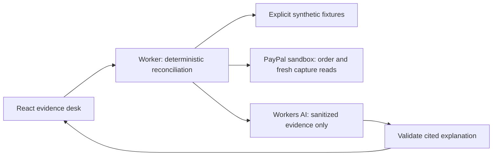

# SettleProof Agreements

A shared record of **what two roles agreed, what a person accepted, and what PayPal actually captured**. The new Agreements workflow connects versioned service milestones, human review, official PayPal SDK Checkout and a hash-linked receipt history. The original evidence desk remains at `/evidence`.

The reviewed Agreements build is deployed. Its actual AI drafting and offline role/delivery/receipt flow have been observed; genuine PayPal SDK approval/capture is pending a dedicated Sandbox application's credential setup. The 17 independent review focuses have explicit outcomes and limits; the real-provider portions remain pending. No new video or hackathon submission is claimed.

Start with [Agreements setup and exact limits](docs/AGREEMENTS-SETUP.md), [17 concept revisions](docs/CONCEPT-17.md) and the [independent product review record](docs/PRODUCT-17.md). Capability links permit demo roles; they do not verify identities. SHA-256 history detects edits relative to a retained prefix anchor; it provides no consensus, immutable storage, delivery certification or guarantee of settlement.

## Evidence desk

The underlying reconciliation engine answers a narrow question: **does this PayPal sandbox order support marking this invoice paid?**

SettleProof compares expected invoice, amount and currency with server-fetched order and capture observations. Deterministic checks own the result. AI explains that result and drafts an internal review note using cited evidence; it cannot change amounts or perform a payment action.

New project started **17 October 2026**. This is a sandbox prototype, with no claimed customers, production transaction volume or automated accounting certification. All included fixture records are synthetic. Fixture demonstrations and live sandbox observations are visibly separate.

**Hosted preview:** [settleproof.ajnasnb.com](https://settleproof.ajnasnb.com), with [workers.dev fallback](https://settleproof.ajnasnb.workers.dev). **Not submitted.** A real PayPal sandbox read is pending the operator's PayPal Developer sign-in. Real Workers AI drafting was observed on 17 October; see [drafting evidence](artifacts/agreement-ai-proof.json). This does not verify the PayPal integration.

## Run locally

Use Node.js 22 or later and npm. From a clean checkout:

```sh
npm ci
npm run check
npm test
node --test scripts/paypal-sandbox.test.mjs
npm run build
npm run dev
```

Open `http://localhost:8797`. The Worker serves the built UI and `/api/*`. Rerun `npm run build` after frontend changes. Synthetic scenarios require no PayPal credentials. Without a configured AI binding, the app should report explanation availability honestly rather than display canned text as generated output.

For local agreement review with no remote bindings, run `npm run dev:offline` instead and open `http://localhost:8798`. Local SQLite storage preserves the separate role/consent/delivery/receipt flow; the object's constructor discards provider credentials as well as the outer Worker. AI and provider access remain disabled. The synthetic evidence desk is at `/evidence`. Use the normal configuration for enabled AI and sandbox verification.

See [sandbox setup](docs/SETUP.md) to configure a fresh test application and produce an actual sandbox order. Do not use a live application, account, payment source or endpoint.

## How it works



- React and **AG Grid Community** provide the evidence queue. Inspect the selected case, filter and sort rows, and export the queue using Community CSV support. No Enterprise modules or purchased grid license are needed.
- PayPal credentials stay on the server. The integration reads an order and rechecks its captures; an order's top-level completion status alone is insufficient payment evidence.
- USD, EUR and GBP with two decimal places are the initial supported currencies. Invalid expectations are rejected. Unknown amounts remain `null`, not fabricated zeroes.
- Cloudflare Workers AI uses `@cf/meta/llama-3.3-70b-instruct-fp8-fast` through the `AI` binding. `AI_ENABLED` defaults to `false`; the operator must deliberately configure and enable provider usage. There is one call per requested explanation, with 450 output tokens requested at most. The `AI_BUDGET` SQLite Durable Object atomically reserves at most 20 inference attempts per UTC day across the app; failures, timeouts and invalid outputs still consume their reservations. `AI_DAILY_LIMIT` may lower that limit, but cannot raise it above 20. Separate per-IP and per-location burst limits are eventually consistent. These controls bound attempts, not dollars or neurons, and administrative namespace resets can reset stored quota state. Unavailable or invalid model output leaves the deterministic analysis available.
- No live-money action, autonomous capture, refund, payout or buyer contact is exposed by the web app. The separate operator-only helper can create/capture **fictitious sandbox** orders after explicit test-buyer approval.

## Privacy and limitations

Use only invented invoice IDs and sandbox records. The browser receives an allowlisted evidence representation rather than PayPal's raw response. Do not enter real customer documents, personal email addresses, API secrets or banking details. AI receives sanitized analysis, not the OAuth token or original PayPal response. Provider requests still follow the configured provider's policies; this project does not claim zero retention by an external service.

This is order/capture reconciliation, not a complete ledger: it does not discover arbitrary historical payments, ingest production webhooks or prove that funds cannot later be reversed. Partial-refund evidence and unavailable capture reads can leave net/remaining amounts unknown. A result is a time-stamped observation, not an audit or guarantee.

## Tests and reproducibility

The latest recorded suite has 74 tests passing, plus seven separate sandbox-helper tests. Coverage includes the original deterministic reconciliation, actual local SQLite quota/state concurrency, SDK transport confinement, role/version transitions, idempotency, retry age, receipt capacity, large UTF-8 verifier inputs and retained-prefix verification. SDK tests mock provider responses. The helper suite uses mocked requests for endpoint confinement, approval gating, input validation and receipt redaction. These tests do not establish genuine PayPal success. Actual AI drafting was observed on an invented brief; a credentialed sandbox walkthrough remains pending.

The [16-point release checklist](docs/RELEASE-CHECKLIST.md) distinguishes requirements from completed verification. [Validation notes](docs/VALIDATION.md) record what this documentation subtask actually checked. API shapes are in [API-CONTRACT.md](API-CONTRACT.md).

The [review-video source and QA record](artifacts/video/README.md) document a completed 100-second local export. It shows synthetic payment cases and an actual Workers AI explanation, with PayPal configuration explicitly pending. The MP4 is a separate local deliverable; no public video or hackathon submission is claimed.

## License and provenance

Project source is [MIT licensed](LICENSE). Retain [third-party notices](THIRD-PARTY-NOTICES.md); regenerate them after dependency changes with `node scripts/licenses.mjs`. Product concepts from the author's earlier work informed the problem selection; their private source, customer data and assets were not copied into this project.

AI assistance is disclosed in the [submission draft](docs/SUBMISSION-DRAFT.md). Generated code and copy require human review. The submitted source, video and run instructions must describe only demonstrated behavior.
